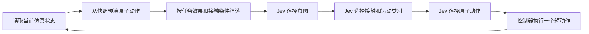
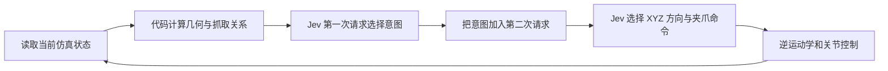

# Jev 在机器人操作中的应用

调研日期：2026 年 10 月 15 日。本文中的 Jev 指 TypeSafe AI 的 System One Model。实现细节以作者代码为依据，评测数字为作者报告；JSON 数值为构造示例，本地尚未复现实验。

TypeSafe AI 的 Jev 根据状态和类型化问题返回决策概率。已有公开项目将它放入机器人操作闭环，负责选择意图、动作方向或技能；感知、几何计算和运动执行仍由其他模块承担。jev-libero 与 RoboJEV 展示了两种不同的职责划分：前者让 Jev 选择已由仿真器预演的方案，后者让 Jev 根据当前状态及几何关系选择意图和动作。

## Jev 的输入输出

TypeSafe 于 2026 年 9 月 15 日介绍 Jev 和 System One Models。官方将其定位为快速、结构化的决策模型，强调在预先定义的输出范围内返回概率。[官方介绍](https://typesafe.ai/blog/introducing-system-one-models-and-jev)

Jev 1.13 和 1.14 都支持图像输入，需要请求头 `TypeSafe-Danger-Zone-Images: true`；1.14 另支持 Box 目标框问题。官方提供 API 服务，本次未找到官方公开权重。以下机器人项目采用结构化状态输入。完整图像接口、版本条件及开放模型比较见 [支持视觉输入的 System One 模型](vision-system-one-models.md)。[官方图像说明](https://docs.typesafe.ai/images)

请求的核心是 `state` 和 `questions`。每个问题定义判断内容和允许的答案，因而候选项说明也是模型输入的一部分。

| 问题类型 | 用途 | 主要输出 |
| --- | --- | --- |
| `choice` | 从命名候选中选一个 | `choice`、各候选的 `probabilities`、`confidence` |
| `noul` | 判断一个陈述是否成立 | 陈述成立的概率 |
| `score` | 按预定义的有序标准评分 | 分值及相应概率信息 |
| `box`，1.14 | 定位图像中的指定目标 | 四条归一化框边及置信度 |

来源：[TypeSafe API 文档](https://docs.typesafe.ai/api)、[Box 专页](https://docs.typesafe.ai/primitives/box)。输出格式受约束和判断正确是两个问题；候选概率也不能直接解释为整项机器人任务的成功概率。下文详解的 jev-libero 和 RoboJEV 没有使用图像输入，这是实现选择，不代表 Jev 没有视觉能力。

## 已有公开项目

| 项目 | 环境及任务 | Jev 的职责 | 公开内容与验证范围 |
| --- | --- | --- | --- |
| [jev-libero](https://github.com/Dimweaker/jev-libero) | LIBERO；关闭微波炉、关闭抽屉、抓取罐头放入篮子 | 从预演并筛选的候选中分层选择 | MIT；代码、配置、轨迹及请求记录；三个内置任务各展示一次成功运行 |
| [RoboJEV](https://github.com/lykycy123/RoboJEV) | MuJoCo 与 Franka Panda；抓放、推物、台座堆放、插孔及障碍抓放 | 根据当前状态选择意图，再选择 XYZ 方向与夹爪命令 | Apache-2.0；代码、规则基线、固定种子评测及失败分析 |
| [piper-astra-jev](https://github.com/RobotKitAI/piper-astra-jev) | 真实 AgileX PiPER；抓放、按手柄抓取及金属零件操作 | 根据感知模块准备的状态选择技能 | Apache-2.0；八个真机演示，其中七个使用 Jev；作者明确说明是单次演示，不是成功率基准 |
| [jev-arm-lab](https://github.com/Vankleben/jev-arm-lab) | MuJoCo 与 xArm7；方块抓放 | 判断下一项技能、抓取状态和任务进度 | MIT；重点研究概率阈值、状态时效与失败原因 |
| [so101-jev](https://github.com/Control-derek/so101-jev) | SO-101 真机；将药盒放到茶盒上 | 根据视觉模块给出的偏移和规则，选择 16 个动作之一 | 代码、三轮逐步日志和演示；第三轮 14 步完成，是单次记录而非成功率基准 |
| [robo-harness](https://github.com/grmkris/robo-harness) | SO-101 真机工作台；关节动作与拾取探索 | 选择有界关节步骤或技能，或否决规则提出的动作 | 公开验收与失败诊断；动作 smoke 已通过，不能将其当作成功抓取评测 |
| [EmbodiedJev](https://github.com/FBddcz/embodied-jev) | MuJoCo 与 Panda；搬运、堆叠、越障 | 根据结构化状态选择技能、短步或分层方向 | MIT；工作台和轨迹导出；Jev 路径与 Chat/Claude 原始图像路径分开 |

这些项目开放的是系统代码及相关实验材料，使用真实 Jev 仍需调用模型服务。so101-jev、robo-harness 和 EmbodiedJev 的视觉输入边界、真机记录及其与原生图像决策的区别，集中见 [视觉 System One 在机器人操作中的应用](vision-system-one-robot-manipulation.md)。

## jev-libero 的控制循环



### 动作和仿真预演

项目预定义 27 种原子动作：世界坐标系 XYZ 各轴分别平移 ±3、±10、±40 mm，共 18 种；绕 XYZ 各轴旋转 ±10°，共 6 种；另有 `open`、`close`、`hold`。Jev 最终返回类似 `x+10mm` 的动作名称。[actions.py](https://github.com/Dimweaker/jev-libero/blob/main/src/jev_libero/actions.py)

每轮从同一个完整快照预演候选动作，单个动作最多执行 8 个 20 Hz 环境步，即 0.4 秒仿真时间。快照包含物理状态、控制器和夹爪状态等，预演结束后恢复，不推进实际任务。MuJoCo 提供动力学结果，FCL 提供碰撞形状距离，代码再计算任务进度、接触和障碍相关特征。[world.py](https://github.com/Dimweaker/jev-libero/blob/main/src/jev_libero/world.py)、[架构说明](https://github.com/Dimweaker/jev-libero/blob/main/docs/architecture.md)

代码按照任务配置的效果条件形成候选池，例如动作能否缩短目标距离、建立接触或推进抽屉关闭。一步候选池为空时，可以进行两步局部搜索：代码为第一步寻找一个能带来净进展的第二步作为依据，但只执行 Jev 选出的第一步，之后重新观察和决策。[任务配置说明](https://github.com/Dimweaker/jev-libero/blob/main/docs/tasks.md)

### Jev 的三层选择

| 层级 | 输入 | 输出 |
| --- | --- | --- |
| `intent` | 任务、当前接触、任务进度、近期结果及可行意图的效果摘要 | 一个局部目标，例如 `advance_target` |
| `strategy` | 已选意图及按预测接触模式和运动类型分组的效果摘要 | 一种接触与运动类别 |
| `motor` | 已选意图、类别、近期结果及每个动作的预测效果 | 一个原子动作名称 |

意图和类别在满足条件时可以沿用，因此每步不一定都调用三次模型。[policy.py](https://github.com/Dimweaker/jev-libero/blob/main/src/jev_libero/policy.py)

以关闭抽屉的 `motor` 请求为例，下面省略了部分字段并构造了预测数值：

```json
{
  "model": "jev-latest",
  "state": {
    "intent": "advance_target",
    "strategy": "fingerpad__translation",
    "recent_real_outcomes": []
  },
  "questions": {
    "motor": {
      "type": "choice",
      "instructions": "比较预测关闭进度和障碍接触，选择一个原子动作。",
      "criteria": {
        "x+3mm": {
          "input": "沿世界X轴移动3毫米",
          "predicted_closing_mm": 1.5,
          "predicted_task_complete": false,
          "predicted_obstacle_peak_force_N": 0
        },
        "x+10mm": {
          "input": "沿世界X轴移动10毫米",
          "predicted_closing_mm": 7,
          "predicted_task_complete": false,
          "predicted_obstacle_peak_force_N": 0
        }
      }
    }
  }
}
```

这类请求中的候选及预测效果均由代码准备。抽屉任务实际使用的字段可见 [top_drawer.json](https://github.com/Dimweaker/jev-libero/blob/main/src/jev_libero/tasks/top_drawer.json)。

响应示意：

```json
{
  "answers": {
    "motor": {
      "choice": "x+10mm",
      "probabilities": {"x+3mm": 0.2, "x+10mm": 0.8},
      "confidence": 0.85
    }
  }
}
```

客户端读取 `choice` 并执行。当前客户端主要用选择结果控制动作，完整响应用于记录；不能据此认为它已经实现了基于校准概率的运动风险控制。[client.py](https://github.com/Dimweaker/jev-libero/blob/main/src/jev_libero/client.py)

### 模型贡献的边界

Jev 负责在所提供的候选中选择。候选生成、未来状态预测、可行性条件和两步搜索均由代码负责。只剩一个候选时，这次调用没有实质性的选择空间。任务成功由 LIBERO 原生判据决定。[职责划分](https://github.com/Dimweaker/jev-libero/blob/main/docs/architecture.md)、[执行循环](https://github.com/Dimweaker/jev-libero/blob/main/src/jev_libero/runner.py)

当前内置演示体现的是“仿真前瞻加模型选择”的完整系统。评估 Jev 的独立贡献，需要在相同候选池和控制器下加入规则或贪心评分基线。

## RoboJEV 的控制循环



### 给模型准备的状态

状态包括任务、机器人末端位姿、夹爪宽度、手指接触、物体位姿和速度、目标区域、几何关系和近期执行结果。代码根据接触及夹爪宽度估计 `held_object`，并把坐标差转换为 `negative`、`zero`、`positive` 方向标签。基本几何关系默认在约 ±6 mm 范围内视为对齐。[state.py](https://github.com/lykycy123/RoboJEV/blob/main/src/jev_vla_sim/state.py)、[geometry.py](https://github.com/lykycy123/RoboJEV/blob/main/src/jev_vla_sim/geometry.py)

因此，模型同时获得数值状态和已经计算好的语义关系。下面是假设方块刚抓住、尚未抬离桌面的输入片段：

```json
{
  "task": "抓起方块并放到目标区域",
  "robot": {
    "held_object": "cube",
    "gripper_width": 0.04,
    "finger_object_contacts": [true, true]
  },
  "relations": {
    "target_from_cube": {
      "directions": {"x": "positive", "y": "positive", "z": "negative"},
      "xy_aligned": false
    },
    "cube_clear_of_table_for_transport": false
  }
}
```

### 两次模型请求

默认配置 `jev_stages=2`。基本抓放任务的第一次请求从 `approach`、`grasp`、`lift`、`carry`、`lower`、`release`、`withdraw`、`finish` 中选择当前意图。这些候选附带明确的物理条件和优先关系；上述示例适合选择 `lift`。任务变化时，意图和规则也会变化。[默认配置](https://github.com/lykycy123/RoboJEV/blob/main/src/jev_vla_sim/config.py)、[policy.py](https://github.com/lykycy123/RoboJEV/blob/main/src/jev_vla_sim/policy.py)

代码把第一次实际选出的意图加入 `state.jev_intent`，第二次请求同时询问四个动作分量：

| 问题 | 候选 |
| --- | --- |
| `x`、`y`、`z` | 各自从 `negative`、`zero`、`positive` 中选择 |
| `gripper` | `open`、`hold`、`close` |

四个问题都能看到前一步意图，在同一次请求中判断。以 `lift` 为例，动作选择可以是：

```json
{
  "x": "zero",
  "y": "zero",
  "z": "positive",
  "gripper": "hold"
}
```

这只是选择结果摘要；真实 API 响应的每个分量还带概率和置信度。模型代码会校验选项及概率格式。[两阶段决策实现](https://github.com/lykycy123/RoboJEV/blob/main/src/jev_vla_sim/policy.py)

### 从选择到机械臂运动

方向被映射为末端增量，默认合成位移长度为 1 cm，多轴同时移动时归一化。插孔接近阶段可使用更小步长。末端姿态保持向下，控制器通过阻尼最小二乘雅可比逆运动学和关节位置控制执行动作。物体运动通过 MuJoCo 接触和摩擦产生，任务成功由独立评估器检查。[types.py](https://github.com/lykycy123/RoboJEV/blob/main/src/jev_vla_sim/types.py)、[mujoco_backend.py](https://github.com/lykycy123/RoboJEV/blob/main/src/jev_vla_sim/mujoco_backend.py)、[实现说明](https://github.com/lykycy123/RoboJEV#how-it-works)

### 作者报告的评测

五项任务各使用 10 个固定种子，对 Jev 与独立规则基线进行配对评测，共 100 个 episode：

| 任务 | Jev | 规则基线 |
| --- | --- | --- |
| 抓放 | 10/10 | 10/10 |
| 表面推物 | 10/10 | 10/10 |
| 固定台座堆放 | 8/10 | 10/10 |
| 宽松插孔 | 10/10 | 10/10 |
| 障碍抓放 | 5/10 | 8/10 |

这些是作者在指定场景中的小样本结果，支持模型能够参与闭环操作，但没有显示出相对规则基线的成功率优势。[评测结果及失败分析](https://github.com/lykycy123/RoboJEV#results)

## 两种方法的比较

| 维度 | jev-libero | RoboJEV |
| --- | --- | --- |
| 视觉输入 | 不向 Jev 发送图像 | 不向 Jev 发送图像 |
| 模型看到的关键信息 | 当前摘要、候选动作及仿真预测效果 | 当前状态、预计算方向与对齐标签、任务规则 |
| 前瞻 | 代码做一步预演，必要时做两步局部搜索 | 主控制循环根据当前状态决策 |
| 决策结构 | 意图、接触与运动类别、原子动作 | 意图、XYZ 与夹爪分量 |
| 低层执行 | LIBERO 与 robosuite 的笛卡尔控制 | 自定义笛卡尔增量、逆运动学和关节控制 |
| 当前最适合研究的内容 | 候选预演与模型选择的配合 | 状态表达、规则遵循与模型的闭环贡献 |

下一步可复用它们的控制接口，把准确仿真状态逐步替换为相机观察，并在保持执行器不变的条件下比较视觉决策模型。Jev 的图像接口与本地模型候选见 [支持视觉输入的 System One 模型](vision-system-one-models.md)。
