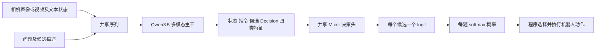

# 支持视觉输入的 System One 模型

调研日期：2026 年 10 月 15 日。

本调研关注：模型根据相机观察、任务指令和可选本体状态，在预定义的候选中快速决策，并返回可供程序使用的概率。这里的“类似 Jev”指接口与用途，不表示架构、训练方法或概率质量相同。

TypeSafe Jev 1.13 和 1.14 本身支持实验性图像输入，1.14 另有 Box。已有机器人项目没有传入图像，不构成模型只支持文本的证据。本文集中记录官方图像 API、开放模型、训练路径及评测边界；Jev 在现有机器人系统中的职责和控制流程见 [Jev 在机器人操作中的应用](jev-robot-manipulation.md)；视觉模型用于机器人操作的闭环证据、相邻方法及实验设计另见 [独立调研](vision-system-one-robot-manipulation.md)。

事实与实现链接到官方文档、作者仓库、模型卡或论文。性能数字均为作者报告，选型属于当前判断；JSON 数值为构造示例。本地尚未调用 Jev 或 OpenAI 决策 API、运行模型或复现实验。模型版本与在线文档可能变化，复现时应固定版本。

## 决策接口与视觉语言模型

本项目关注的接口形态是：相机观察、任务指令和可选本体状态作为证据，问题及候选项作为约束，模型返回选项概率，程序把选择映射为机器人动作。

普通 VLM 也能生成动作标签或 JSON。这里关注专门的类型化决策接口及候选概率读出。公开实现中，Clef 联合评分多个字段，Visual Jev 复用图像前缀并分别计算问题分支；托管 API 的外部行为不能直接证明内部架构，不能把所有方案归为同一种并行计算方式。[Clef 发布说明](https://blog.cloudflare.com/clef-decision-models/)、[Visual Jev 方法](https://github.com/guanxuyu-sv/Visual-Jev)

## 模型总览

| 模型 | 规模及基座 | 输入输出 | 公开材料 |
| --- | --- | --- | --- |
| [Jev 1.13 与 1.14](https://docs.typesafe.ai/images) | 官方未在本次核查材料中公开规模 | 实验性静态图像与类型化判断，1.14 另有 Box | 托管 API；图像请求需显式开启；未找到官方公开权重 |
| [GPT-6 Luna Decisions API](https://developers.openai.com/api/docs/guides/decisions) | `gpt-6-luna`；本次材料未披露决策路径架构 | 文本和图像；`predicate`、`choice`、`score` 及概率 | OpenAI 托管 API，public beta；本次未找到对应公开权重或决策训练代码 |
| [OneJev](https://github.com/OmniJev/OneJev) | 0.8B、4B、9B、27B；当前 README 推荐 1.5 | 文本、图像、视频，单次前向类型化概率 | Apache-2.0；代码、权重、训练配方 |
| [decider-2b-vision](https://huggingface.co/Mapika/decider-2b-vision) | Qwen3.5-2B 视觉语言模型加 v5 文本权重 | 图像、问题、候选答案 logits | Apache-2.0；代码和权重；像素游戏及 PPO 实例，英语限定 |
| [d1-3B](https://huggingface.co/LiquidAI/d1-3B) 与 [d1-omni-600M](https://huggingface.co/LiquidAI/d1-omni-600M) | LFM 视觉语言主干或双向编码器加多模态编码器 | 图像与文本；600M 还支持文本与音频，但单次不同时接收图像和音频 | 开放权重和推理代码，LFM Open License |
| [Valen](https://github.com/Liuziyu77/Valen) | Qwen3.5 的 0.8B、2B、4B 版本加 Mixer | 文本、图像、视频；shared-state 多题候选概率 | 代码、完整模型、SFT 与实验性 RLCD |
| [Clef 与 Clef-Flash](https://huggingface.co/Cloudflare/clef-flash) | Clef 27B 基于 Qwen3.8；Flash 9B 基于 Qwen3.5 | 文本、JSON、图像、视频；类型化问题及选项概率；兼容 Jev/SystemOne | Apache-2.0；完整权重、决策头及推理代码 |
| [Imajev](https://github.com/mohit67890/imajev) | Qwen3.5 的 2B、4B、9B 版本 | 照片、文本状态、两张图比较；选项概率、`unknown_probability`、`abstained` | Apache-2.0；代码、适配器、校准文件及本地服务 |
| [Visual Jev](https://github.com/guanxuyu-sv/Visual-Jev) | 发布了 Qwen3-VL-4B 的答案监督 LoRA | 图像、共享上下文和多个候选问题；各问题的概率分布 | [论文](https://arxiv.org/abs/2609.25845)、代码及 [Apache-2.0 适配器](https://huggingface.co/guanxuyu/visual-jev-4b-answer-sft) |
| [OmniJev](https://github.com/tinnel123666888/OmniJev) | Qwen3.5 的 0.8B、2B、4B 版本 | 图像、多图、视频帧及文本；`choice`、`noul`、`score` | Apache-2.0；代码、适配器、数据和分任务报告 |
| [shapsider/OmniJev](https://github.com/shapsider/OmniJev) | Qwen3.5-9B 加纠错读出；当前发布 v4 | 图像、问题、候选分布及 act/hold | 仓库 MIT；[v4 LoRA 与决策头](https://huggingface.co/tzcfly/OmniJev-Qwen3.5-9B-v4)标 Apache-2.0；闭环记录使用 v3 |
| [AutoTrust JEV-27B-VL](https://huggingface.co/autotrust/JEV-27B-VL) | Qwen3.8-27B 加 System 1 适配器和决策头 | 图像及文本；有限选项概率；另保留生成式路径 | Apache-2.0；权重、服务代码及视觉机器人演示 |
| [PlayJev-0.8B](https://github.com/OmniJev/PlayJev) | Qwen3.5-0.8B-Base，针对十种游戏训练 | 游戏截图和动作菜单，直接输出动作概率 | Apache-2.0；权重、环境、记录及闭环复现；机械臂迁移待验证 |

Jev 与 GPT-6 Luna 分别提供 TypeSafe 和 OpenAI 的托管决策服务，其余为独立模型或实现。部分权重包仅含适配器或决策头，需要另行加载对应的视觉基座。复现时应使用项目提供的决策推理路径；模型托管页面自动生成的聊天示例未必会调用决策头。

## Jev 1.13 与 1.14

TypeSafe 的 [Images 专页](https://docs.typesafe.ai/images)明确说明 Jev 1.13 和 1.14 都接受图像；[Box 专页](https://docs.typesafe.ai/primitives/box)说明目标框问题需要 1.14。图像和 Box 默认关闭，每次相关请求需要显式开启。

| 能力 | Jev 1.13 | Jev 1.14 |
| --- | --- | --- |
| 文本与结构化状态 | 支持 | 支持 |
| 静态图像与类型化判断 | 开启图像功能后支持 | 开启图像功能后支持 |
| Box 目标定位 | 不支持 | 开启图像功能后支持 |
| 权重开放 | 本次未找到官方公开权重 | 本次未找到官方公开权重 |

本次读取的 [模型总览](https://docs.typesafe.ai/models)仍把输入列为 Text，与 Images 专页不一致；此前“Jev 仅支持文本”的结论因此需要更正。当前以明确列出版本、格式和限制的功能专页为依据。[官方文档索引](https://docs.typesafe.ai/llms.txt)也列出了 Images、Box 和图像 SDK 对象；[OpenRouter 多模态文档](https://openrouter.ai/docs/guides/community/multimodal-decisions)同时列出两个版本的图像支持。这里确认的是静态图像接口，不能由此推导出原生视频或音频支持。

### TypeSafe 原生图像接口

使用 `POST https://api.typesafe.ai/v1/systemone`，含图像或 Box 的请求需要以下请求头：

```text
TypeSafe-Danger-Zone-Images: true
```

原生接口通过顶层 `assets` 保存图片，在 `state`、`instructions` 或 `criteria` 的字符串值中引用资产。PNG 或 JPEG 可使用 multipart 上传，或在 JSON 中放入普通 base64。原生 `data_base64` 不带 `data:` 前缀。这与 OpenRouter 的 `image_url` data URL 格式不同。[原生上传和引用说明](https://docs.typesafe.ai/images)

以下是请求结构示例；`<PNG_BASE64>` 是占位符，没有执行请求：

```json
{
  "model": "jev-1.14.0",
  "state": {"frame": "9d52c461-5ad3-42da-a17d-6e54b590d2a0"},
  "assets": {
    "9d52c461-5ad3-42da-a17d-6e54b590d2a0": {
      "type": "image",
      "format": "png",
      "data_base64": "<PNG_BASE64>"
    }
  },
  "questions": {
    "visible": {
      "type": "noul",
      "instructions": "Is a red cube visible in `frame`?"
    },
    "target": {
      "type": "box",
      "instructions": "the red cube in `frame`"
    },
    "alignment": {
      "type": "choice",
      "instructions": "Where is the cube relative to the gripper in the image plane?",
      "criteria": {
        "left": "To the left of the gripper.",
        "right": "To the right of the gripper.",
        "aligned": "Horizontally aligned.",
        "unclear": "Insufficient visible evidence."
      }
    }
  }
}
```

原生资产引用按字符串匹配，宜使用不会意外出现在其他文本中的唯一标识。这里的方向判断仍需由机器人控制器映射到运动坐标。

### Box 输出与图像限制

Box 返回 `top`、`bottom`、`left`、`right`，均为相对图像尺寸的 0 至 1 数值，另带置信度。它总会返回一个框，没有“未找到”结果；应另问目标是否存在，再决定是否采用框。目标框提供的是图像位置，不直接提供三维位姿或抓取轨迹。[Box 输出和使用方式](https://docs.typesafe.ai/primitives/box)

官方将图像和 Box 标为早期原型功能，格式、限制和准确率可能变化。图像专页要求 PNG/JPEG 静态图，每边 256 至 1568 像素，且总像素至少 78,400；因此常见的 256×256 仿真截图低于面积下限。机器人实验必须记录所用图像预处理，并遵循该接口的尺寸条件。[图像限制](https://docs.typesafe.ai/images#limits)

### OpenRouter 接口

OpenRouter Decisions 接口把图像作为 `state` 数组中的 `image_url` 项发送，值为 base64 data URL；模型标识形如 `typesafe/jev-1.14`。不要把它与 TypeSafe 原生接口的 `assets` 和 `data_base64` 混用。原生实验请求头的要求应按 TypeSafe 文档处理，聚合服务的要求则以该服务接口为准。[OpenRouter 多模态接口](https://openrouter.ai/docs/guides/community/multimodal-decisions)

[OpenRouter Jev 说明](https://openrouter.ai/docs/guides/community/jev)另提供图像与 Box 请求示例。Jev 可作为托管视觉 API 基线，与下列本地模型在相同观察、动作候选和执行器下比较。

## GPT-6 Luna 与 OpenAI Decisions API

本次核查的 OpenAI Docs 使用名称 **GPT-6 Luna**，模型标识为 `gpt-6-luna`；未找到用户提及的“GPT-6.1 Luna”这一官方名称。[模型目录](https://developers.openai.com/api/docs/models)

专用端点是 `POST https://api.openai.com/v1/decisions`，当前为 public beta，仅支持 `gpt-6-luna`。输入可包含文本和图像，输出是类型化答案。它与 Responses API 的 JSON Schema 输出有不同接口约定。[Decisions 指南](https://developers.openai.com/api/docs/guides/decisions)

| 问题类型 | 输出含义 | 机器人接入示例 |
| --- | --- | --- |
| `predicate` | 条件为真的概率；用途近似 Jev 的 `noul` | 夹爪是否对齐、物体是否仍在夹爪内 |
| `choice` | 所选值、候选概率数组及 confidence | 在限定的短动作中选择下一步 |
| `score` | 有序等级索引的概率加权平均及等级分布 | 按明确标准评估对齐或任务进度 |

同一请求支持 1 至 200 个问题；Choice 支持 2 至 255 个唯一候选。顶层使用 `input`，问题使用数组和 `name`，候选使用 `choices` 数组，与 Jev 的 `state`、问题字典及 `criteria` 不同。[接口参考](https://developers.openai.com/api/reference/resources/decisions/methods/create)

以下是机器人视觉请求结构，图片为占位符，未调用 API：

```json
{
  "model": "gpt-6-luna",
  "input": [{
    "role": "user",
    "content": [
      {"type": "input_text", "text": "Align the open gripper above the red cube. Directions refer to the image plane."},
      {"type": "input_image", "image_url": "data:image/png;base64,<PNG_BASE64>"}
    ]
  }],
  "questions": [
    {
      "type": "predicate",
      "name": "aligned",
      "instructions": "Is the gripper visibly centered above the red cube?"
    },
    {
      "type": "choice",
      "name": "next_action",
      "instructions": "Choose one small horizontal alignment action.",
      "choices": [
        {"value": "move_left", "description": "Move the projected gripper position slightly left."},
        {"value": "move_right", "description": "Move the projected gripper position slightly right."},
        {"value": "hold", "description": "Keep position if aligned or visual evidence is insufficient."}
      ]
    }
  ]
}
```

返回 `answers` 数组，按 `name` 对应问题；某题也可能返回 `refusal`。控制器负责动作映射和执行。多题请求适合共享观察的独立判断；若后题依赖前题答案，官方建议分开请求。[接口参考](https://developers.openai.com/api/reference/resources/decisions/methods/create)、[多题使用说明](https://developers.openai.com/api/docs/guides/decisions#ask-multiple-questions)

官方宣称该接口相对 Responses API 约快 10 倍，这不是与 Jev 的对比，也不是机器人端到端延迟保证。当前基础价格为每百万输入 tokens 0.10 美元，无输出及缓存读写费用；区域处理溢价和长上下文倍率另计。[价格与可用性](https://developers.openai.com/api/docs/guides/decisions#pricing-and-availability)

从接口用途判断，它适合加入 SystemOneRobot 的托管视觉决策基线。本次材料没有建立其内部决策头、前向次数或完整机械臂操作成功率；概率阈值仍需机器人标注数据校准。已有 SO-101 真机接入原型的证据与限制见 [机器人操作调研](vision-system-one-robot-manipulation.md)。

## OneJev

OneJev 接受文本、图像或视频，以及运行时提供的问题和候选；一次前向返回 Choice、Noul、Score 等类型化结果及概率。它适合作为可进一步训练的视觉决策模块，尚需单独验证机械臂闭环表现。[接口与模型](https://github.com/OmniJev/OneJev)

OneJev 当前 README 记录：2026 年 9 月 27 日发布初版，10 月 13 日发布 1.5；启动示例已使用 `OmniJev/OneJev1.5-4B`。用户提供的 [OneJev-4B](https://huggingface.co/OmniJev/OneJev-4B) 是初版模型入口，复现实验应区分版本。[当前仓库](https://github.com/OmniJev/OneJev)

公开训练配方对 Qwen 系列进行 SFT，冻结视觉塔，使用交叉熵和 Brier 损失，并提供四个尺寸的配置。可再分发数据包含原始 99,193 道训练问题中的 94,707 道；未能再分发的来源不会因打包模型而改变数据许可。[训练和数据说明](https://github.com/OmniJev/OneJev#training)

不同后端的多模态范围不同：PyTorch 路径支持文本、图像和视频；llama.cpp 路径文档标注支持文本及图像，视频应使用 PyTorch。模型名称相同不能替代后端能力检查。此前记录的其他 OmniJev 仓库仍按各自地址辨识，不把同名项目自动视作 OneJev 的同一版本。

## Valen

Valen（万澜）值得加入 SystemOneRobot 的首批实验候选。它支持图像、视频和文本输入，直接对请求提供的候选评分，并开放了模型、数据格式、训练和评估代码。它适合研究视觉判断与有限动作选择；当前公开证据主要覆盖图像和视频问题及游戏决策，尚不能据此认定具备成熟的机械臂操作能力。

项目入口：[Liuziyu77/Valen](https://github.com/Liuziyu77/Valen)。本文区分新版 0.8B、2B、4B 与较早的 Preview，并以公开实现为依据；下文性能数据均为作者报告，本地尚未运行权重或复现实验。

### 发布版本与开源范围

| 日期 | 发布内容 |
| --- | --- |
| 2026 年 9 月 23 日 | 仓库、Valen-Preview-0923 及对应训练数据 |
| 2026 年 10 月 7 日 | Valen 0.8B、2B、4B 和 VisualDecisionBench |
| 2026 年 10 月 13 日 | API 访问及 ONNX、GGUF 版本 |

来源：[项目更新记录](https://github.com/Liuziyu77/Valen#news)。代码采用 Apache-2.0；基础模型及来源数据集保留各自许可。独立论文未在本次核查的官方入口中找到，当前主要技术材料是仓库文档、实现和模型卡。

| 权重 | 发布形态与需要注意的版本差异 |
| --- | --- |
| [Valen-0.8B](https://huggingface.co/Valen-Team/Valen-0.8B) | 小规模视觉决策模型，适合纳入资源和速度对比 |
| [Valen-2B](https://huggingface.co/Valen-Team/Valen-2B) | 当前根目录为完整模型，包含处理器和自定义加载代码；配置和权重提交记录显示全参数 shared-state SFT，参数保存为 FP32，主干使用 BF16 autocast |
| [Valen-4B](https://huggingface.co/Valen-Team/Valen-4B) | 模型卡描述为两阶段 SFT，联合训练语言 LoRA、Mixer 和视觉 merger；根目录已合并 LoRA，包含完整主干和决策头 |
| [Valen-Preview-0923](https://huggingface.co/Valen-Team/Valen-Preview-0923) | 早期 checkpoint，加载和评测流程与新版不同，不应混用其性能数字 |

2B 的当前文件列表约为 8.88 GB，这是模型包体积，并非运行所需显存。0.8B、2B、4B 的训练和存储方式不能仅凭名称推断一致。复现时应固定模型 revision、代码版本、计算精度及媒体处理参数。[2B 文件和提交记录](https://huggingface.co/Valen-Team/Valen-2B/tree/main)、[2B 配置](https://huggingface.co/Valen-Team/Valen-2B/blob/main/config.json)、[4B 模型卡](https://huggingface.co/Valen-Team/Valen-4B)

### 新版模型怎样计算决策

新版公开模型以 Qwen3.5 的多模态主干为基础，接入两层 MLP-Mixer 决策头。主干读取图像、文本、问题和候选，决策头输出每个候选的一个 logit，再在同一问题内归一化。其决策路径不需要生成答案文本，也不使用词表输出层进行逐 token 解码。[架构说明](https://github.com/Liuziyu77/Valen/blob/main/docs/architecture.md)、[2B 模型说明](https://huggingface.co/Valen-Team/Valen-2B)



Mixer 为每个候选读取四类主干特征：共享状态的平均池化、该题指令的平均池化、候选描述的平均池化，以及对应 `Decision:` 位置的隐状态。默认两层 Mixer 混合这四类角色及其通道，最后读出候选角色的标量得分。决策头参数在候选间共享；Mixer 自身不把不同候选当作混合维度，候选之间的上下文联系可由主干产生。[heads.py](https://github.com/Liuziyu77/Valen/blob/main/valen/modeling/qwen/heads.py)

对第 q 个问题的候选 k，可以概括为：

```text
z[q,k] = Mixer(state_feature, instruction_feature, candidate_feature, decision_feature)
p[q,:] = softmax(z[q,:] / temperature)
```

这是视觉语言基座上的候选评分模型。候选数量由请求决定，适合在固定执行器之上尝试不同动作菜单。

### shared_state 与逐题模式

| 模式 | 计算过程 | 对实验的影响 |
| --- | --- | --- |
| `shared_state` | 同一序列放入一次状态、全部问题和候选、各题 Decision 位置，主干一次前向后读出全部问题 | 避免为各题重复执行完整主干；问题顺序、候选顺序和其他问题可能影响结果 |
| `question` | 按题或分支执行，沿用较早输入形式；Score 的等级可以形成多个分支 | 不能把处理器只编码一次误认为主干只运行一次 |

新版 shared-state 使用普通因果注意力，题目之间没有独立性保证。它不等同于 Visual Jev 的隔离问题分支。将一题单独询问与放入多题请求中询问，应分别检查预测是否变化。[shared-state 文档](https://github.com/Liuziyu77/Valen/blob/main/docs/qwen-shared-state.md)

### 机器人输入输出示例

以下是根据实际 schema 构造的接入示例，不是已运行轨迹。`image_url` 的本地推理路径指向本地媒体文件；虽然字段名带 URL，仓库编译器会拒绝 HTTP 等带 `://` 的路径。`state` 使用消息对象时可以放入多个媒体条目。[数据格式](https://github.com/Liuziyu77/Valen/blob/main/docs/data-format.md)

```json
{
  "state": {
    "messages": [{
      "role": "user",
      "content": [
        {
          "type": "text",
          "text": "Task: align the gripper above the red cube. Directions in the options refer to the image plane. The gripper is currently open."
        },
        {"type": "image_url", "image_url": {"url": "assets/robot_frame.png"}}
      ]
    }]
  },
  "questions": {
    "next_action": {
      "type": "choice",
      "instructions": "Choose one small alignment action from the visible observation.",
      "criteria": {
        "move_left": "Move the projected gripper position slightly left in the image.",
        "move_right": "Move the projected gripper position slightly right in the image.",
        "hold": "Keep position because alignment is sufficient or the direction is unclear."
      }
    },
    "grasp_ready": {
      "type": "noul",
      "instructions": "The gripper is visibly aligned and ready to begin the grasp approach."
    }
  }
}
```

候选描述进入模型输入，并非只作为程序标签。基本格式约束为：`choice` 支持 1 至 255 个命名候选，`noul` 使用固定真假候选，`score` 使用 2 至 10 个有序等级。机器人部署需要另外定义图像平面动作到机械臂坐标的转换，示例本身不完成这个映射。[候选定义](https://github.com/Liuziyu77/Valen/blob/main/docs/data-format.md)

响应示意中的数字均为构造值：

```json
{
  "model": "Valen",
  "answers": {
    "next_action": {
      "type": "choice",
      "choice": "move_right",
      "probabilities": {"move_left": 0.1, "move_right": 0.8, "hold": 0.1},
      "confidence": 0.7
    },
    "grasp_ready": {"type": "noul", "noul": 0.18}
  }
}
```

程序可取 `choice` 执行一个有界动作，再读取下一帧重新判断。机械臂轨迹、逆运动学、关节控制和成功判据仍需由机器人系统实现。

### 概率与 confidence 的含义

`choice` 返回各候选概率及最大概率候选；`noul` 返回 `P(true)`；`score` 返回零起点等级索引的期望值及等级分布。以 K 个候选为例，Choice 的置信度换算是：

```text
K = 1 时 confidence = 1
K > 1 时 confidence = max(0, (max(p) - 1/K) / (1 - 1/K))
```

因此，示例中三选一的最大概率 0.8 被换算为 `confidence=0.7`。这个字段描述相对于均匀分布的集中程度，不是独立学习的抓取成功率。加入 `unknown` 或 `hold` 也只是提供候选，不自动保证拒答或概率已经适配机器人场景。[响应实现](https://huggingface.co/Valen-Team/Valen-2B/blob/main/responses.py)、[推理与评估文档](https://github.com/Liuziyu77/Valen/blob/main/docs/evaluation.md)

### 训练方法与自有数据

公开框架支持两阶段 SFT：先预热决策头，再联合更新。LoRA 路径更新语言适配器、Mixer 和视觉 merger；全参数路径可更新整个主干及决策头。新版完整权重可以作为进一步微调的起点，仓库已经提供相应配置。[训练指南](https://github.com/Liuziyu77/Valen/blob/main/valen/training/README.md)、[LoRA 微调配置](https://github.com/Liuziyu77/Valen/blob/main/configs/train/qwen/sft_finetune_lora.json)

SFT 用目标分布监督候选 logits，基本目标是交叉熵；可选 Brier 项及 Score 的 RPS 项。标签可以是一热分布，也可以是软分布。机器人数据可以表示为一条相机观察和多道有监督问题，例如动作方向、是否抓住、是否可以释放；这些标签仍需来自演示、可验证物理状态或明确的标注流程。

实验性 RLCD 从候选分布中采样离散答案，采用 GRPO 风格的组内优势、裁剪策略优化、参考 KL 和 Brier 辅助项。它需要标签；当前实现不等于已经建立“机械臂在环境中交互并获得任务回报”的机器人强化学习流程，也不能假定复现了 TypeSafe 未公开的训练方法。[训练目标说明](https://github.com/Liuziyu77/Valen/blob/main/valen/training/README.md)

默认训练配置指向 smoke 数据并设置短步数上限。复现训练时必须替换数据和预算，不能把运行默认配置视为重现发布模型的训练。

### 作者报告的评测

#### 新版模型结果

| 模型 | VisualDecisionBench Image 准确率 | VisualDecisionBench Video 准确率 | 公共 JevBench 准确率 |
| --- | --- | --- | --- |
| Valen 0.8B | 75.94% | 79.03% | 77.92% |
| Valen 2B | 80.41% | 82.85% | 83.55% |
| Valen 4B | 83.06% | 87.36% | 83.12% |

来源：[新版结果图](https://github.com/Liuziyu77/Valen#results)、[2B 模型卡](https://huggingface.co/Valen-Team/Valen-2B)。这些是作者公布的指定模型与协议结果，本地没有复现，也不足以单独证明 Mixer 相比相同基座的其他读出方式存在因果收益。

#### VisualDecisionBench 的计分范围

该基准有 1,696 个共享视觉状态、9,143 道题。图像子集为 2,000 题，视频子集为 7,143 题；其中图像的 300 道 AVA 软标签评分题不参与硬标签准确率，图像准确率的分母为 1,700。视频按 16 帧采样。视频部分 Score 和 Noul 标签为经过同模型验证的合成银标签，应结合标签来源解释成绩。[数据集与评测协议](https://huggingface.co/datasets/Valen-Team/VisualDecisionBench)

所有标签可参与 NLL 和 Brier，Score 另报告等级期望误差和 RPS。公开评测脚本输出逐题预测和分类汇总，便于进一步检查不同问题类型和数据来源。[评测实现](https://github.com/Liuziyu77/Valen/blob/main/evaluation/visualdecisionbench/evaluate.py)

#### 游戏闭环与机器人证据

仓库提供完整 Sokoban 环境、精确求解器、截图策略和逐局评测，模型根据截图、规则及候选选择下一步。该任务可以检验连续决策，但物理接触、位姿估计和机械臂控制不在其评测范围内。[Sokoban 评测](https://github.com/Liuziyu77/Valen/blob/main/evaluation/sokoban/README.md)

在本次核查的官方仓库、模型卡和任务评估入口中，未找到机械臂仿真操作成功率、真机结果或可直接使用的机器人执行器。Valen 因而应作为待验证的视觉决策基座，与已验证操作策略分别描述。

### 对 SystemOneRobot 的价值

| 研究需求 | Valen 提供什么 | 需要补充什么 |
| --- | --- | --- |
| 直接读取机器人相机图像 | 原生图像和多图消息 | 相机、裁剪及坐标约定 |
| 一帧多个判断 | shared-state 多问题读出 | 顺序敏感性和多题相互影响评测 |
| 动态动作菜单 | 运行时提供候选名称与描述 | 稳定的动作语义、执行器和合法性条件 |
| 低成本进一步训练 | 0.8B 至 4B、LoRA 与全参数配置 | 机器人数据、监督标签和计算预算 |
| 根据不确定性决定行动 | 完整概率分布和温度接口 | 在机器人分布上校准和选择阈值 |
| 连续操作 | 可复用决策循环 | 物理闭环、异常恢复和独立成功检查 |

Valen-2B 可作为首批可训练候选，同时保留 0.8B 用于资源对比、4B 用于质量对比。完整视觉请求延迟需要在目标硬件上测量，再据此决定控制频率。

## decider-2b-vision

视觉版本把 decider-2b v5 的语言权重放入完整 Qwen3.5-2B 视觉语言模型。训练包括游戏帧、通用多选视觉任务和文本回放；之后在 Breakout、Pong 中从像素进行 PPO，候选动作概率就是策略。[模型卡](https://huggingface.co/Mapika/decider-2b-vision)

模型卡给出的像素游戏结果每项只评测三局，且在若干未见过的游戏上失败。其视觉权重沿用 v5，不包含纯文本 decider 后续 v6 至 v10 的全部改进；不能借用较新纯文本版的浏览器成绩评价这个视觉 checkpoint。模型卡明确限制为英语，其校准结果只覆盖列出的数据。[限制与版本记录](https://huggingface.co/Mapika/decider-2b-vision#limitations)

它对 SystemOneRobot 的价值在于：候选 logits 可以直接作为离散策略参与训练，已有从像素采样环境回报的代码实例。机械臂仍需另建动作空间、执行器和任务评测。

[Mapika/decider 代码仓库](https://github.com/Mapika/decider)公开视觉决策加载、游戏环境及策略训练入口，代码和视觉权重采用 Apache-2.0。

## Liquid AI d1

Liquid AI 于 2026 年 10 月 7 日发布这两个开放权重模型。d1-3B 基于解码器式 LFM2.5-VL-3B，接收文本及图像；d1-omni-600M 基于双向 LFM2.5-Encoder-350M，并加入视觉和音频编码器。[官方发布说明](https://www.liquid.ai/blog/d1-open)

d1-omni-600M 约有 587M 参数，是较小的多模态决策模型。单次请求可用文本加图像，或文本加音频，不能同时提供图像和音频。图像输入时，状态和问题的文本会按训练设置裁到 896 tokens；不能把它的 16,384 总位置预算理解为图像场景可任意添加同长度文本。[600M 接口及模型详情](https://huggingface.co/LiquidAI/d1-omni-600M)

这两个 checkpoint 可用于本地推理基线。公开材料中的视觉问题成绩和设备速度需要保留各自输入及计时条件；不应直接当作机器人相机闭环的控制频率。

两者采用 LFM Open License，应与 Apache-2.0 分开记录。开放权重和推理实现不等于公开了完整训练数据及训练过程。

## Clef 与 Clef-Flash

Cloudflare 于 2026 年 10 月 1 日介绍这两个决策模型。模型执行视觉语言基座的前向计算，再由联合 schema 决策头为允许的选项评分，不依赖逐 token 生成答案文本。[官方发布说明](https://blog.cloudflare.com/clef-decision-models/)

Clef-Flash 支持 Jev/SystemOne 请求：`state`、`questions`，以及额外的 `images`、`videos`。`choice` 响应包含选择、概率和置信度。公开模型包包含视觉基座和决策头，文档提供 Python 加载及 SGLang 服务方式。[模型及视觉接口](https://huggingface.co/Cloudflare/clef-flash#images-and-video)

当前判断：它适合先验证“保留有限选项控制接口，把图像加入模型输入”的路线。兼容接口减少调用层改动，但机器人动作选择和视觉概率校准仍需在目标任务上评估。

## Imajev

Imajev 使用 Qwen3.5 视觉基座、语言层适配器及候选决策读出。支持最多两张图像，可以联合参考图、当前图及文本状态进行判断。项目提供 2B、4B、9B 适配器，4B 是作者推荐的默认版本；公开包需要配合对应基座加载，并提供 CUDA 和 Apple Silicon 服务流程。[项目说明](https://github.com/mohit67890/imajev)、[4B 权重](https://huggingface.co/mohit67890/imajev-4b)

输出包含 `unknown_probability` 和 `abstained`。Choice 的候选概率按“可以回答”这一条件归一化；项目示例会将所选项概率乘以 `1 - unknown_probability`，再结合弃权标记决定是否行动。[开发接口](https://github.com/mohit67890/imajev#for-developers)

这是经过训练的未知输出机制，但机器人场景中的遮挡、抓空、视野外目标仍需单独验证。现有图片与记录核对、分类等结果，不代表机器人闭环成功率。它适合研究目标图比较、状态确认和拒答；其 README 对 Jev 仅文本的历史比较不覆盖 TypeSafe 当前的图像接口。

## Visual Jev

Visual Jev 将同一图像和共享文本编码为可复用前缀，多个独立问题作为分支批量计算。推荐版本是 Qwen3-VL-4B 的答案监督 LoRA，在答案位置读取已有语言模型头的候选 token 概率。[方法和代码](https://github.com/guanxuyu-sv/Visual-Jev)

公开 quickstart 支持每题 2 至 16 个候选的 `choice`，首次运行下载基座和适配器，支持 CUDA 或 MPS。论文比较了普通答案监督与额外决策头，二者在匹配条件下的四任务宏平均均约为 0.761，未显示额外线性决策头的稳定收益。[模型卡](https://huggingface.co/guanxuyu/visual-jev-4b-answer-sft)、[论文](https://arxiv.org/abs/2609.25845)

作者在 RTX 5090 上报告，同一图像 32 个问题的共享前缀批量耗时约 182 ms，折合每题 5.7 ms。后一个数值是吞吐摊销，不是单次独立请求延迟；单问题场景下共享前缀还有额外开销。[测量条件](https://github.com/guanxuyu-sv/Visual-Jev#results-at-a-glance)

当前判断：它适合研究机器人一帧观察中“抓住了吗、是否对齐、下一步方向”等多个判断的计算共享。

## OmniJev

此处特指 [tinnel123666888/OmniJev](https://github.com/tinnel123666888/OmniJev)，避免与其他同名仓库混淆。v1.1 提供 0.8B、2B、4B 版本，支持多图和视频帧，并包含机器人场景中的子任务、方向、抓取和完成状态等问题。[版本和权重](https://github.com/tinnel123666888/OmniJev#released-models)

作者明确说明，公开机器人演示属于记录轨迹的离线回放，部分输入可能与训练重合，可靠的机器人闭环控制尚未建立。因此这些演示适合了解接口和问题设计，不能当作模型实际驱动机械臂的成功率。[能力和演示范围](https://github.com/tinnel123666888/OmniJev#what-it-can-do)

### shapsider/OmniJev

[shapsider/OmniJev](https://github.com/shapsider/OmniJev)是另一个独立项目，当前主模型为 Qwen3.5-9B 加 v4 纠错读出，接收图像与问题，输出候选分布及 act/hold。仓库采用 MIT；公开的 [v4 LoRA 与残差头](https://huggingface.co/tzcfly/OmniJev-Qwen3.5-9B-v4)标 Apache-2.0，需要另行加载基座。

其不同版本的直接视觉控制与技能控制记录，集中见 [机器人操作调研](vision-system-one-robot-manipulation.md)，不能与 tinnel 的模型或实验混用。

## AutoTrust JEV-27B-VL

[AutoTrust JEV-27B-VL](https://huggingface.co/autotrust/JEV-27B-VL)基于 Qwen3.8-27B，提供 System 1 适配器、决策头和服务代码，采用 Apache-2.0。它接收图像与文本，返回有限候选的概率，同时保留生成式路径；这是独立实现。

作者说明决策头使用文本训练，视觉能力迁移自视觉语言基座。其机器人闭环代码、逐场景结果和抓取物理限制，集中见 [视觉 System One 在机器人操作中的应用](vision-system-one-robot-manipulation.md)。

## PlayJev-0.8B

PlayJev 以 Qwen3.5-0.8B-Base 为基础，针对十种浏览器游戏训练。推理读取截图及动作菜单；教师使用游戏内部状态产生标签，公开训练过程包含行为克隆和 DAgger。应区分“教师可访问内部状态”和“模型推理只看像素”。[训练配方](https://github.com/OmniJev/PlayJev#-training-recipe)

作者以每个游戏 16 个留出 episode 评测，并让随机策略和教师使用相同种子。模型、记录、环境和复现脚本均公开，因而它提供了比单帧问答更直接的连续动作选择实例。十种游戏的任务定制训练不构成机械臂零样本迁移证据。[闭环结果](https://github.com/OmniJev/PlayJev#-results)

## 当前选型判断

| 目标 | 优先候选 | 原因 |
| --- | --- | --- |
| 托管视觉决策 API 对照 | Jev 1.13/1.14、GPT-6 Luna Decisions | 都支持图像及类型化概率，使用同一观察与动作集比较；Jev Box 需要 1.14，OpenAI Decisions 当前为 beta |
| 另一套可训练的多模态候选 | OneJev 1.5 的 4B 版本 | 推理服务、训练配方与权重公开，区分旧版 OneJev-4B |
| 像素离散策略训练参考 | decider-2b-vision 与 PlayJev | 分别提供像素 PPO 或教师标注加 DAgger 实例，游戏证据与机器人证据分开 |
| 不同基座与小模型对照 | d1-3B 与 d1-omni-600M | 有本地视觉决策路径，600M 属实验 checkpoint，许可与 Qwen 系列分开记录 |
| 可进一步训练的视觉机器人决策基线 | Valen-2B | 多模态输入、候选概率、训练及评测路径公开，需补充机器人数据和执行器 |
| 快速搭建能读图的 Jev 兼容服务 | Clef-Flash 9B | 接口明确，完整视觉权重及决策头公开 |
| 较小模型的本地基线 | imajev-4B | 提供服务、未知输出和适配器，便于围绕具体问题实验 |
| 多问题共享图像计算的方法研究 | Visual Jev 4B | 有匹配实验、论文及复现代码 |
| 小模型的机器人场景判断 | OmniJev 0.8B 至 4B | 包含相关问题设计，需另做闭环验证 |
| 视觉迁移与本地服务对照 | AutoTrust JEV-27B-VL | 公开视觉基座上的决策适配器、概率接口及服务代码 |
| Qwen 9B 的纠错读出对照 | shapsider/OmniJev | 公开 v4 LoRA 与残差头，需配合对应基座 |

这些是实验分工，不是性能排名。通用视觉问答、游戏闭环、机械臂仿真和真机结果应分别记录；不同数据集、样本量和硬件条件的数字不能直接横向排名。

机器人操作的实际闭环、结果边界和统一实验方案见 [视觉 System One 在机器人操作中的应用](vision-system-one-robot-manipulation.md)。
