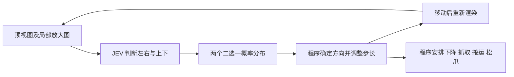

# 视觉 System One 在机器人操作中的应用

调研日期：2026 年 10 月 15 日。

本文集中回答：是否已有视觉 System One 模型直接参与机器人操作，模型读取什么、输出什么，以及公开实验能够支持哪些结论。分别记录直接图像决策闭环、视觉策略特征上的偏好学习、真机原型，以及感知后再交给文本决策模型的混合系统。

模型清单、图像 API、训练接口及模型级评测见 [支持视觉输入的 System One 模型](vision-system-one-models.md)；TypeSafe Jev 在 jev-libero、RoboJEV 等系统中的控制流程见 [Jev 在机器人操作中的应用](jev-robot-manipulation.md)。

事实与实现链接到作者仓库、模型卡、官方文档或论文。性能数字均为作者报告，本地尚未运行模型或复现实验；本文的实验设计为待执行方案。模型、代码与实验版本应分别固定。

## 调研结论与证据分级

2026 年 10 月 15 日深入核查：已有相关公开工作，但证据层级不同。本调研直接匹配的路径是“相机图像、问题和候选 → 决策概率 → 执行动作 → 新图像”。JevVLA 则是在视觉策略特征上训练偏好能量，是重要的相邻方法。以下结果均未由本地复现。

| 工作 | 实际决策输入与作用 | 操作证据 | 当前判断 |
| --- | --- | --- | --- |
| [AutoTrust JEV-27B-VL](https://huggingface.co/autotrust/JEV-27B-VL) | 顶视图与局部放大图，回答目标相对夹爪的方向 | 简化 MuJoCo 抓放 15/20；逐场景 JSON 与控制代码公开 | 直接相关的视觉闭环；抓取使用程序附着，不能等同于接触丰富的机械臂抓取 |
| [shapsider/OmniJev](https://github.com/shapsider/OmniJev/blob/main/results/qwen35-suite/EMBODIED.md) | 合成桌面图、问题和候选，v3 一次前向选动作 | 12 回合完成 8 回合；约 72 ms/决策 | 直接视觉闭环的概念验证；不是其 MuJoCo 技能视频的成绩，v4 尚未复测 |
| [JevVLA](https://github.com/ZJU4EmbodiedAI/JevVLA) | 冻结视觉策略的上下文特征与动作特征，能量重排或梯度修正 | 作者展示五个操作基准的提升，公开核心训练、推理和评估代码 | 方法上高度相关；不是通用 RGB 加类型化问题模型，权重、完整复现材料与许可仍待核实 |
| [GPT-6 Luna＋SO-101](https://zenn.dev/oggata/articles/2ba348f605cbc1) | 双相机图片直接进入 Decisions，判断方向、可见性及抓取条件 | 有真机运行、请求片段和失败记录；作者将完整抓放成功确认列为后续工作 | 直接相关的真机视觉原型，尚非已完成任务的评测或完整开源系统 |
| [tinnel123666888/OmniJev](https://github.com/tinnel123666888/OmniJev#what-it-can-do) | 机器人图像上的子任务、方向、抓取和完成判断 | 官方明确演示是离线轨迹回放 | 具有视觉机器人判断，尚未证明模型驱动操作闭环 |
| [LLM2Jev 抓放演示](https://github.com/Yinsongxu/LLM2Jev/blob/main/demos/pick_place/mujoco_demo.py) | 模型请求只含 task 与程序准备的 available_actions | Panda/MuJoCo 抓放演示 | 工具支持图像不等于该演示传入图像，不计作视觉决策闭环 |
| [so101-jev](https://github.com/Control-derek/so101-jev)、[robo-harness](https://github.com/grmkris/robo-harness) | 相机先被转换为偏移、检测或文本，再交给 Jev | SO-101 真机运行；任务和动作 smoke 的验证范围各不相同 | 是真机混合系统，尚不是图像直接进入决策模型的证据 |

此次在官方仓库、模型卡、演示入口及交叉检索中，尚未找到 Valen、OneJev、Clef、d1、Imajev、Visual Jev 或 decider 的可核验机械臂视觉操作闭环评测。OpenAI Decisions 已有上表所列真机原型，但完整任务成功仍待验证。这个结论限定于本次找到的公开材料，不表示这些模型不能完成任务，也不表示不存在未公开或尚未检索到的工作。decider、PlayJev 和 Valen 的游戏闭环应单独记录。

当前尚未核实“通用视觉类型化决策模型直接读取真实机械臂相机，并完成多任务、重复试验”的公开结果。后文分别展开直接相关工作和相邻方法，已有状态输入真机系统见 [Jev 机器人应用](jev-robot-manipulation.md)。

## AutoTrust JEV-27B-VL

这是本次能对照模型卡、控制代码和逐场景结果的直接视觉抓放闭环。它不是 TypeSafe 官方 Jev；模型与服务代码公开，采用 Apache-2.0。决策头训练使用文本，视觉判断迁移自视觉语言基座，没有因此建立机器人专项训练的证据。[模型卡与实验说明](https://huggingface.co/autotrust/JEV-27B-VL#new-3-october-2026-robot-arm-and-computer-use)

### 闭环与职责



控制代码的 `servo()` 每轮串行询问左右和上下，方向翻转时减小步长。`episode2()` 固定抓取与放置阶段。模型决定平面方向；阶段安排、垂直运动、抓取及成功判据归程序所有。[robot_arm.py](https://huggingface.co/autotrust/JEV-9B/blob/main/vl/demos/robot_arm.py)

模型读取原始顶视图，在步长较小时另看局部裁剪；场景给夹爪投影加黑点。它没有得到目标物体坐标，但程序仍使用仿真夹爪位置生成裁剪。这是带明确几何约定的视觉伺服，不是未标定相机下的通用六自由度策略。

### 数字能够支持的结论

| 条件 | 完成 | 请求计时与范围 |
| --- | --- | --- |
| JEV-27B-VL，方向判断加程序伺服 | 15/20，75% | 中位单次决策约 239 ms；平均每回合 48.9 次决策 |
| JEV-27B-VL，直接八选一运动命令 | 0/10 | 中位单次决策约 242 ms；每回合最多 45 步 |
| 同一作者公布的 JEV-9B 伺服结果 | 10/20，50% | 模型卡约 163 ms/次 |
| 同一作者公布的 GEV-26B-Decide 伺服结果 | 8/20，40% | 模型卡约 61 ms/次 |

27B 的原始统计见 [arm_servo.json](https://huggingface.co/autotrust/JEV-27B-VL/blob/main/reports/demos/arm_servo.json)和 [arm_direct.json](https://huggingface.co/autotrust/JEV-27B-VL/blob/main/reports/demos/arm_direct.json)，另有 [完整结果目录](https://huggingface.co/autotrust/JEV-27B-VL/tree/main/reports/demos)，家族比较来自模型卡。两种控制结构的样本数和预算不同，不能据此把 75 个百分点解释为单一架构收益。每轮伺服需要两次串行请求，239 ms 也不是完整动作周期。

### 抓取物理的关键限制

源码使用 mocap 龙门式夹爪；低位闭爪且距离方块小于 3 cm 时，将物体标记为 held，随后直接更新其位姿跟随夹爪。它验证了简化环境中的视觉定位与搬运顺序，尚未验证双指接触、摩擦和失抓。原先仅写“MuJoCo 抓放 75%”不够完整，应保留这一限定。[抓取与位姿更新代码](https://huggingface.co/autotrust/JEV-9B/blob/main/vl/demos/robot_arm.py)

这套代码最适合借鉴简单空间问题、程序伺服和逐回合记录。复用到真实机械臂时，应重新验证抓取与释放，不能继承 75% 的成功率。源码页面标示短提交 `b63f651`，27B 结果页面标示 `f34b598`；正式复现还应固定完整 revision 与服务配置。

## JevVLA：视觉策略上的偏好能量

[ZJU4EmbodiedAI/JevVLA](https://github.com/ZJU4EmbodiedAI/JevVLA)是重要的相邻工作。它受 Jev 的概率决策思想启发，在冻结的机器人策略上训练约 79,817 参数的能量核心；没有调用 TypeSafe Jev，也不是加载 Valen、OneJev 等通用视觉决策模型。

### 输入、输出与两种用法

能量核心接收上下文特征和数值动作特征。它的视觉证据经过原策略编码器，核心自身不直接读取 RGB 或自然语言候选说明。CLIPort 适配器包含视觉、语言及状态特征；LIBERO 适配器把 2048 维策略前缀与 8×7 的候选动作块编码到统一接口。[CLIPort 适配器](https://github.com/ZJU4EmbodiedAI/JevVLA/blob/main/src/jevvla/adapters/cliport.py)、[LIBERO 适配器](https://github.com/ZJU4EmbodiedAI/JevVLA/blob/main/src/jevvla/adapters/libero.py)

```text
图像与任务 → 冻结视觉策略 → 上下文 c 与动作候选 a
候选选择：p(a|c) ∝ p₀(a|c) exp(-β E(c,a))
连续修正：a' = a - η ∇a E(c,a)
```

第一条路径重排策略提出的候选，第二条对动作或动作块作有界梯度修正。两者共享能量形式，但每个基准分别训练权重。[能量模型](https://github.com/ZJU4EmbodiedAI/JevVLA/blob/main/src/jevvla/model.py)、[选择与修正实现](https://github.com/ZJU4EmbodiedAI/JevVLA/blob/main/src/jevvla/inference.py)

### 作者报告的操作结果

| 基准 | 冻结基线 | Direct | JevVLA | 提升 |
| --- | --- | --- | --- | --- |
| MetaWorld MT50 | π₀.₅–MT50 | 75.84% | 77.12% | 1.28 个百分点 |
| VIMA L1 | VIMA-200M | 84.77% | 87.08% | 2.31 个百分点 |
| LanguageTable | Language BC | 78.00% | 79.60% | 1.60 个百分点 |
| LIBERO Plus | π₀.₅–LIBERO | 78.63% | 80.15% | 1.52 个百分点 |
| CLIPort | CLIPort | 34.22% | 35.50% | 1.28 个百分点 |

来源：[作者项目页](https://zju4embodiedai.github.io/JevVLA/)。CLIPort 明确采用严格任务成功判据；这些是不同基准及策略条件下的结果，不能平均成通用操作成功率。网页的 3D Action Lab 明确是方法示意，另外的配对帧才标为评估记录；不能把网页动画当作真机实验。

### 公开程度与复现缺口

已核查到核心模型、训练、特征适配器和 [在线 rollout 评估器](https://github.com/ZJU4EmbodiedAI/JevVLA/blob/main/src/jevvla/evaluation.py)。训练入口要求用户准备特征与监督 NPZ，在线评估要求另外提供环境、策略和成功函数工厂；离线 candidate-record 评分和在线闭环成功率不是同一种评估。

本次查看的 README、项目页和代码入口尚未找到明确的已训练权重下载、完整逐回合原始日志、全部样本量和多次训练方差，也未确认独立论文及明确开源许可证。因此当前应写作“代码公开、作者报告操作提升，复现材料待补”，不能写成已经独立复现的现成模型。[README](https://github.com/ZJU4EmbodiedAI/JevVLA)、[包配置](https://github.com/ZJU4EmbodiedAI/JevVLA/blob/main/pyproject.toml)

它对 SystemOneRobot 的启发是：除直接选择离散方向外，还可在 VLA 提出的动作块上学习概率或偏好。候选覆盖率、可行性与额外特征信息仍需消融。

## shapsider/OmniJev：版本与闭环证据

这是另一个独立项目，当前主模型为 Qwen3.5-9B 加 v4 纠错决策头。公开 [LoRA 与残差头](https://huggingface.co/tzcfly/OmniJev-Qwen3.5-9B-v4)需要单独加载基座，不能与 tinnel 的 4B 权重混用。

它至少包含三类记录，需要按版本与环境区分：

| 记录 | 实际条件 | 能说明什么 |
| --- | --- | --- |
| MuJoCo 工作台搬运、堆叠、越障视频 | 特权仿真状态加预设技能，程序执行 IK 轨迹 | 技能决策流程；不能作为直接视觉规划成绩 |
| 双相机 direct vision 模式 | RGB 发送给模型，逐步动作与扰动入口公开 | 提供视觉闭环实验接口，不能直接沿用技能视频的成功结果 |
| Qwen3.5-9B v3 合成桌面放置 | 红块、绿目标和夹爪的合成画面，模型不见坐标；关掉空白帧和虚假说明 | 12 回合成功 8 回合，约 72 ms/决策，是较小的直接视觉闭环验证 |

前两类的输入边界由 [README](https://github.com/shapsider/OmniJev#embodied-experiments-and-results-display)说明；第三类见 [EMBODIED.md](https://github.com/shapsider/OmniJev/blob/main/results/qwen35-suite/EMBODIED.md)。思考基线只跑了两个已被 v3 成功完成的种子，0/2，不能作为同规模完整比较。

[技术报告](https://github.com/shapsider/OmniJev/blob/main/docs/TECHNICAL_REPORT.md)明确说明，8/12 属于 v3，当前 v4 没有重跑闭环。不要把 v4 的 923 道视觉选择题成绩、v3 的桌面完成率和较早 Nemotron 后端的工作台视频拼成一个结果。仿真等待模型时会暂停，回放速度也不能作为真实控制频率。

## GPT-6 Luna 与 SO-101 真机视觉伺服原型

Fumitoshi Ogata 于 2026 年 10 月 9 日公开了 [Decisions API 驱动 SO-101 的开发记录](https://zenn.dev/oggata/articles/2ba348f605cbc1)。两路相机图片直接送入 `gpt-6-luna`，通过 Predicate 和 Choice 判断可见性、方向及抓取条件；程序以红十字作对齐参照，再用视觉方向标定、IK 和 LeRobot 执行。

作者报告约 0.3–0.7 秒/次判断，记录了真机动作与失败。但文章将确认完整抓取并放入篮子列为后续工作，仓库 URL 仍是占位符。本次因此确认视觉决策接入真机的原型，不确认任务成功率、完整源码可用性或稳定抓放能力。

## 视觉感知加结构化 Jev 的系统边界

### so101-jev

固定相机和腕部相机先交给视觉模型，生成 `target_offset_cm`、是否夹住等结构化事实。Jev 请求不带图像，在 16 个平移、腕部、夹爪与完成选项中选择，随后重新观察。[项目输入输出](https://github.com/Control-derek/so101-jev#how-it-works)

作者公开三轮：第一轮视觉描述包含动作建议，虽成功但作者不计；第二轮只给事实的散文描述，失败；第三轮结构化偏移加固定规则，14 步、约 6.5 分钟完成。它提供真实硬件闭环证据，但视觉感知和空间偏移提取由另一模型承担；不能归入 Jev 原生读图操作成功率。[三轮结果](https://github.com/Control-derek/so101-jev#results)

### robo-harness

决策设计明确规定“图像不进入 Jev”：腕部白色物体检测器、夹爪状态和可选视觉模型描述先转成文本。程序准备关节候选和技能，Jev 作选择或否决。[决策设计](https://github.com/grmkris/robo-harness/blob/main/docs/decisions/0011-decision-runner.md)

2026 年 9 月 17 日的验收记录包含规则与 Jev 的真机关节动作 smoke，以及拾取过程中的感知、执行和设备负载失败。Jev Choice 的 5/5 指该次小动作检查中的完成步骤，不是五个抓放 episode。记录中的两次自主拾取尝试未建立完成抓取的结果，不能把“真机控制已通”扩写为“视觉抓放成功”。[真机验收记录](https://github.com/grmkris/robo-harness/blob/main/docs/acceptance-2026-09-17-jev-decision.md)

### EmbodiedJev

工作台支持原始 RGB 逐步动作，但 README 将它限定给支持图像的 Chat/Claude 路径；Jev 实现接收结构化状态或本地 RGB-D 检测结果。它可以用作共享执行器和对照平台，当前不能把图像模式的效果归给 Jev。[控制模式与输入](https://github.com/FBddcz/embodied-jev#-方法论模型做选择物理验证结果)

部分项目 README 仍把 Jev 描述为仅文本。这只能描述其接入实现或当时接口认知，不能覆盖 TypeSafe 当前的图像文档。Jev 原生图像接口及版本条件见 [支持视觉输入的 System One 模型](vision-system-one-models.md)。

## 容易误计为视觉操作闭环的工作

| 工作 | 核查到的实际情况 | 本次处理 |
| --- | --- | --- |
| LLM2Jev MuJoCo pick-and-place | `choose()` 构造的请求只包含 task 与 available_actions，渲染画面用于录像；菜单由程序根据仿真状态准备 | 记录为状态/候选输入的控制演示，排除出原生视觉闭环 |
| tinnel OmniJev 机器人视频 | 概率叠加在记录轨迹上，部分输入可能与训练重合 | 记录为离线判断，不能由视频推算操作成功率 |
| EmbodiedJev 的直接图像模式 | RGB 目前接给 Chat/Claude 逐步模式；项目的 Jev 路径接结构化文本 | 可借鉴执行器和实验记录，不能将 Chat 的视觉结果归给 Jev |
| SO-101 与 PiPER 的感知加 Jev 系统 | 感知模块先生成偏移、坐标或文本事实，Jev 再决策 | 属于视觉辅助系统，区别于决策模型自己读图 |
| RLCD 人机交接研究 | 研究模型概率、规则与人类介入；README 明确实体实验在仿真中，真实数据是离线探针 | 对校准和接管有参考价值，尚不构成原生图像驱动真机操作的证据 |
| STEERIX robo-jev / robojev bench | 比较 Jev、d1、GPT-6 Luna 等模型，但 README 明确输入是描述感知状态的短文本 | 物理判断及闭环环境工具，不能据模型支持图像便改写为视觉输入评测 |

来源：[LLM2Jev 请求代码](https://github.com/Yinsongxu/LLM2Jev/blob/main/demos/pick_place/mujoco_demo.py)、[tinnel 演示边界](https://github.com/tinnel123666888/OmniJev#v11-replay-demos)、[EmbodiedJev 输入说明](https://github.com/FBddcz/embodied-jev#-方法论模型做选择物理验证结果)、[so101-jev](https://github.com/Control-derek/so101-jev)、[robo-harness 决策设计](https://github.com/grmkris/robo-harness/blob/main/docs/decisions/0011-decision-runner.md)、[RLCD](https://github.com/maskedband1t/RLCD)。TypeSafe Jev 项目总览及 jev-libero、RoboJEV 的控制流程另见 [机器人应用文档](jev-robot-manipulation.md)。

[robo-jev README](https://github.com/STEERIX-home/robo-jev)与 [bench 页面](https://robo-jev.dev/)把机器人环境、状态文本和模型槽位分开描述。其分数反映特定物理判断协议，不能替代图像操作成功率。

## 机器人论文中的另一种 System One 用法

| 工作 | System One 的含义 | 与本调研的关系 |
| --- | --- | --- |
| [GR00T N1](https://arxiv.org/abs/2503.14734) | 在视觉语言模块之后，以扩散 Transformer 生成机器人动作；原论文包含 GR-1 真机双臂操作 | 已有真实操作证据，但不是 Choice/Noul/Score 候选决策接口 |
| [OneTwoVLA](https://arxiv.org/abs/2505.11917) | 统一 VLA 在推理与动作模式间切换，操作过程中按需推理 | 包含复杂操作与恢复，是视觉动作策略路线 |

两者适合作为机器人策略参照。GR00T 的 [代码仓库](https://github.com/NVIDIA/Isaac-GR00T)与模型许可分别记录；OneTwoVLA 公开了 [训练与部署代码](https://github.com/Fanqi-Lin/OneTwoVLA)和数据入口。不能因为名称里有 System One，就认定它们验证了通用视觉决策头的效果。

## 对 SystemOneRobot 的研究判断

| 研究方向 | 主要参考 | 当前需要补齐的证据 |
| --- | --- | --- |
| 图像直接决定短动作，再由程序伺服 | AutoTrust JEV-27B-VL | 真实接触抓取、统一动作预算与多任务复测 |
| 小规模视觉闭环及版本可追溯性 | shapsider/OmniJev | 用发布权重重跑闭环，并分开记录技能控制与直接视觉控制 |
| 冻结 VLA 的候选重排或连续修正 | JevVLA | 权重、许可、完整在线评估配置与逐回合记录 |
| 双相机图像接入真实机械臂 | GPT-6 Luna＋SO-101 | 完整源码、重复抓放试验及独立任务成功检查 |

这些方向代表不同的系统职责，不能按现有数字直接排名。通用视觉模型的候选选择能力、程序控制器的先验和物理抓取能力需要分别评估。具体模型选型与接口见 [模型调研](vision-system-one-models.md)。

## 统一实验与评估

1. **固定任务与执行器。** 首先选择单物体抓放，统一机械臂、短动作候选及执行控制器，使用独立物理判据判定任务完成。图像平面方向到机器人运动坐标的映射需要明确实现。
2. **比较观察条件。** 分别评估准确仿真状态、图像加本体状态、仅图像。逐步去掉准确位姿、接触和预计算方向标签，检查视觉模型承担感知后闭环表现如何变化。
3. **隔离决策路径的贡献。** 对比规则策略、同基座普通 VLM 的受约束动作或 JSON 生成，以及直接读取候选概率。候选、图像及执行器保持一致；若加入动作预演，单独消融预演，区分模型、状态表达和规划代码的收益。
4. **比较问题组织。** 对同一帧分别测试单题动作选择、多题动作加抓取状态判断、先意图再动作。检查问题及候选换序、多题相互影响和重复动作；串行请求计入总延迟，共享前缀的摊销吞吐与独立请求延迟分别报告。
5. **区分训练、校准与测试。** 按 episode 和场景划分数据，避免连续帧进入不同划分。先测冻结模型，再测机器人 SFT 或策略训练的增益；训练标签来自演示、可验证物理状态或明确标注。验证遮挡、抓空、目标不在视野内和没有合适候选时的拒答行为，不能直接把最大选项概率或 confidence 当成任务成功率。
6. **报告完整闭环指标。** 至少包含任务成功率、碰撞、抓空、重复动作、决策次数、端到端 p50/p95 延迟、资源占用及概率校准误差。先测完整视觉请求再决定控制频率；记录模型 revision、代码版本、计算精度、媒体预处理及服务后端。

以上为待执行的研究设计，当前仓库仅保存调研材料。

针对本次找到的证据，优先做两条实验：一是让通用视觉决策模型在真实接触的仿真操作中控制同一组短动作，二是在冻结 VLA 的相同候选动作块上比较原始先验、规则重排和学习偏好。把图像输入、候选生成、抓取物理和控制代码分别固定，才能判断模型贡献。当前不能据此次检索宣称“首次将视觉 System One 用于机器人操作”；更具体的研究空间是可复现的真实接触闭环、跨任务泛化和机器人分布上的校准。
